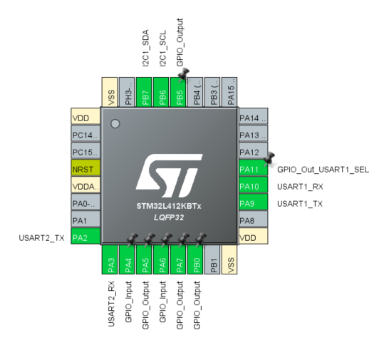

# STM32CubeIDE Setup
1. clone the repo
2. in stm32cubeide, File->Import, then open drop down menu for General and select Existing Projects into Workspace
3. The Import Projects Window should open. Select "Select root directory" and browse to the path of `your_repo_path/cube_ide_proj`. Still in the window, go down to Options, and select "Copy projects into workspace".
4. Click Finish to exit Import Projects window

# Updated IOC/pinout

